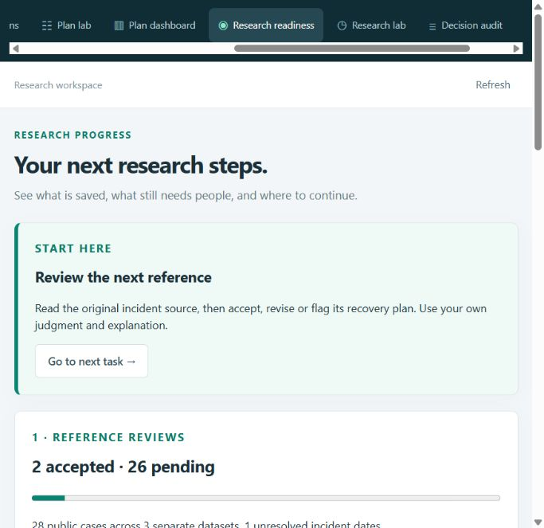

# CalibratedOps

**Human oversight, confidence calibration, and review of AI incident-recovery proposals.**

**[Open the live demo](https://calibratedops.onrender.com/)** · [Run locally](#run-locally) · [Documentation](#documentation)

CalibratedOps helps people inspect agent proposals, challenge uncertain recommendations, and record recovery decisions. It combines source-backed incident datasets, confidence calibration, multi-step plan review, and supervised research workflows in a single-user web application.

**Status:** implemented and tested with **151 regression tests**. Empirical research evaluation remains ongoing; software verification does not establish real-world effectiveness.

All infrastructure actions are simulated. This independent project was inspired by the [Ericsson thesis topic](https://jobs.ericsson.com/careers/job/563121777275159-thesis-human-in-the-loop-calibrated-agent-harness-karlskrona-blekinge-sweden); it is not affiliated with Ericsson.



## Live demo

Visit **[calibratedops.onrender.com](https://calibratedops.onrender.com/)** to explore the working application. **No sign-in is required.** Start with **Load demo incidents**, or open **Dataset lab** to inspect the bundled public cases.

The demo runs on Render's Free plan and may take about a minute to wake after inactivity. It uses shared, temporary sample data: changes can disappear on restart or redeployment. Live AI is disabled. Use the demo for exploration, and keep private information and genuine participant responses in a separately managed research workspace.

## Run locally

Requires **Python 3.10 or later**. The application uses the Python standard library and SQLite, with no third-party runtime dependencies. The offline demonstration needs no API key or internet connection.

Clone the repository and start the server:

```powershell
git clone https://github.com/Dhara092005/CalibratedOps.git
cd CalibratedOps
python -m calibrated_ops serve
```

Open **[http://127.0.0.1:8767/](http://127.0.0.1:8767/)** and keep the terminal running. Press `Ctrl+C` to stop. On Windows, you can also double-click `start.cmd` in the project folder.

The `127.0.0.1` address works only on the computer running the server. For online access, use the HTTPS live-demo link above.

To use a different port or a separate workspace:

```powershell
python -m calibrated_ops serve --port 8770 --database runs/another-study.sqlite3
```

The local server binds to `127.0.0.1`. It supports single-user operation and supervised participant sessions, one person at a time. It has no separate participant accounts.

## Deployment

The repository includes a Docker image and a Render Blueprint for the public demo. The default configuration uses the **Free** plan with no paid disk, seeds the public incident collections, and marks the workspace as temporary. Local databases, reviews, and participant records are not uploaded by a Git deployment. See the [deployment guide](docs/DEPLOYMENT.md) for configuration, container checks, and private-hosting options.

## Features

| Workspace | Purpose |
| --- | --- |
| **Incident queue** | Inspect evidence, uncertainty, and impact risk; approve, change, or reject simulated proposals. |
| **Experiment lab** | Compare automatic, review-all, selective raw-confidence, and selective calibrated-confidence policies on synthetic cases. |
| **Dataset lab** | Import CSV/JSON datasets, preserve source groups across splits, and evaluate frozen predictions. |
| **Label review** | Review sources, labels, dates, recovery actions, and prerequisites; preserve revisions and create frozen reviewed versions. |
| **Prediction runs** | Save and resume offline or explicitly authorized live prediction runs. |
| **Plan lab** | Generate multi-step proposals, record human edits or rejection, and compare against frozen reference structures. |
| **Plan dashboard** | Track batches, generation failures, decisions, and paired structural comparisons. |
| **Research readiness** | View reference-review progress, trial submissions, independent scoring coverage, calibration gaps, and next-task shortcuts. |
| **Research lab** | Run counterbalanced evidence-only/AI-assisted trials with pauseable timing and independently scored written explanations. |
| **Decision audit** | Inspect persisted decisions, feedback, and simulated execution events. |

The application stores its state in SQLite and provides JSON exports. CLI experiments also produce CSV and Markdown reports.

## First walkthrough

1. Open **Incident queue** and select **Load demo incidents**.
2. Inspect a proposal, its evidence, risk, and confidence estimates.
3. Record an approval, correction, or rejection, then inspect **Decision audit**.
4. Use **Experiment lab** to compare oversight policies on synthetic data.
5. Open **Research readiness** and select **Go to next task** to continue the research workflow.

For a presentation, follow the [demo guide](docs/DEMO.md). For multi-step recovery review, see the [Plan lab guide](docs/PLAN_LAB.md).

## Incident datasets

The repository includes fictional examples and **28 public incident cases** across an original collection and two separately staged collections. Public cases contain short paraphrases, source links, and provisional labels/reference plans. They are not independently validated ground truth or a representative telecom benchmark.

Import the original 17-case collection:

```powershell
python -m calibrated_ops import-public
```

Import the two additional staging collections and export review worksheets:

```powershell
python scripts/prepare_research_materials.py --add-cases
python scripts/prepare_research_materials.py --add-cases --case-file calibrated_ops/data/additional_public_incidents_v2.json
python scripts/export_reference_worksheets.py
```

The worksheets contain proposed reference answers. Keep them separate from unfamiliar participants' materials. Imports do not create human approvals, and the staged collections are not automatically pooled for calibration.

For your own dataset, use **Dataset lab**. Required fields are `id`, `group_id`, `evidence`, `risk`, and `label`. Supply `split` for every row, or omit it for every row to use seeded group assignment. Optional frozen predictions require `proposed`, `confidence`, and `agent_id` together. Related incidents must stay in one split; duplicate IDs and normalized duplicate evidence are rejected.

See the [dataset format](docs/DATASETS.md), [public-source notes](docs/PUBLIC_DATASET.md), and [second staged collection](docs/PUBLIC_CASES_V2.md).

## Research workflow and status

1. **Review references.** Check proposed recovery steps and dependencies against the original sources. Record actual reviewers' decisions and explanations.
2. **Prepare participant sessions.** Recruit consenting people unfamiliar with the assigned cases; complete the information sheet before collection.
3. **Run supervised trials.** Research lab freezes the proposals and references, counterbalances conditions, and records genuine responses and active timing segments.
4. **Score understanding independently.** After study closure, two reviewers use separately randomized, condition-masked packets to score written explanations.
5. **Evaluate calibration and report results.** Use accepted references and a sufficiently populated, frozen cohort with separate calibration, validation, and test groups.

Research readiness reports saved progress without exposing participant answers or comparative outcomes. Preparing a study does not count as collecting participant responses. Reviewer identities and independence are self-declared.

Plan-confidence evaluation requires at least **20 eligible cases per split** within one dataset/model/prompt cohort, with no source-group overlap or normalized duplicate evidence across splits. This is an implementation readiness guard, not a statistical power guarantee. Structural agreement measures actions, ordering, and declared prerequisites; it does not establish semantic correctness, operational feasibility, or safety.

The current research data does not support claims of real-world effectiveness, improved human understanding, or calibrated recovery-plan quality. Synthetic demonstrations and software tests do not substitute for empirical evidence.

Use the [completion checklist](docs/RESEARCH_COMPLETION_CHECKLIST.md), [recruitment pack](docs/RECRUITMENT_PACK.md), and [research protocol](docs/RESEARCH_PROTOCOL.md).

## Reproduce experiments and reports

```powershell
# Synthetic policy benchmark and repeated-seed study
python -m calibrated_ops benchmark
python -m calibrated_ops study --repeats 20

# Offline evaluation of a labeled example
python -m calibrated_ops dataset calibrated_ops/data/example_incidents.csv

# Public-incident plan evaluation and report from saved records
python scripts/research_report.py --evaluate-public
```

Synthetic study artifacts are written to `runs/study/`. The saved-data project report is written to `runs/research-report/`. The public evaluation command generates or reuses offline plan jobs; it makes no paid API requests and preserves human decisions.

The single-action simulator and recovery-plan confidence evaluation are separate analyses. Calibration is fitted on calibration data; validation and test data are not used to fit it. See the [sample synthetic results](docs/SAMPLE_RESULTS.md) and [research protocol](docs/RESEARCH_PROTOCOL.md) for methods and limitations.

## Optional live AI generation

The public demo disables live AI. Offline features work without configuration. For a local or separately protected workspace, enable the OpenAI adapter by entering your API key privately in the PowerShell terminal that starts the server:

```powershell
$secret = Read-Host 'OpenAI API key' -AsSecureString
$env:OPENAI_API_KEY = [System.Net.NetworkCredential]::new('', $secret).Password
$env:OPENAI_MODEL = 'your-model-id'
python -m calibrated_ops serve
```

Choose a model available to your account that supports the Responses API and structured outputs. Live generation sends the selected incident evidence and impact risk to OpenAI and may incur API charges. Plan lab requires an accepted reference and explicit authorization before live generation.

The API key stays in the server environment. `.env` files are not loaded automatically. Live AI and custom rule proposals require human review; self-reported confidence is not empirical calibration. No agent executes infrastructure commands.

## Verification

Run the regression suite:

```powershell
python -m unittest discover -s tests -v
```

With Node.js installed, check all frontend JavaScript files:

```powershell
Get-ChildItem calibrated_ops/static -Filter '*.js' | ForEach-Object {
    node --check $_.FullName
    if ($LASTEXITCODE -ne 0) { throw "JavaScript syntax check failed: $($_.Name)" }
}
```

Tests cover storage, review revisions, grouped evaluation, HTTP routes, concurrency, research trials, scoring, and readiness counts. They use temporary databases and mocked provider responses. HTTP tests require loopback socket access. GitHub Actions runs the Python suite on Python 3.10 and 3.14.

The deployment workflow also builds the Docker image and checks private authentication, public-demo access, origin restrictions, API writes, and temporary-storage behavior. See [GitHub Actions](https://github.com/Dhara092005/CalibratedOps/actions).

## Data handling

The default database is `runs/calibrated_ops.sqlite3`. Use a different `--database` path to create an isolated workspace. For a file-copy backup, stop the server first so SQLite can checkpoint its write-ahead log.

Participant responses, evidence, feedback, and exports may contain sensitive information. Storage inside a synced folder can be copied by that sync service. Agree access, retention, withdrawal, and sharing arrangements before participant collection. This local app does not provide authenticated reviewer identities or a tamper-proof audit trail.

Git ignores `runs/`, SQLite databases, `.env` files, virtual environments, and generated build artifacts. Review staged files before publishing; do not commit API keys, participant responses, private exports, or backups. The source-only archive command excludes runtime records:

```powershell
python scripts/package_project.py
```

Output: `runs/CalibratedOps-project.zip`.

## Project structure

```text
calibrated_ops/      Application, agents, storage, evaluation, and research workflows
  data/             Fictional fixtures and attributed public-incident collections
  static/           HTML, CSS, and JavaScript interface
scripts/            Research reports, review worksheets, and source packaging
tests/              Automated regression and container checks
docs/               Architecture, protocols, guides, and presentation materials
.github/workflows/  Continuous integration
Dockerfile          Hosted application image
render.yaml         Free live-demo deployment configuration
```

## Documentation

- [Architecture and API](docs/ARCHITECTURE.md)
- [Deployment guide](docs/DEPLOYMENT.md)
- [Guided reference review](docs/GUIDED_REVIEW.md)
- [Recovery plans and prerequisites](docs/RECOVERY_PLANS.md)
- [Prediction runs](docs/PREDICTION_RUNS.md)
- [Batch plan evaluation](docs/PLAN_BATCHES.md)
- [Research protocol](docs/RESEARCH_PROTOCOL.md)
- [Research completion checklist](docs/RESEARCH_COMPLETION_CHECKLIST.md)
- [Final handover](docs/FINAL_HANDOVER.md)
