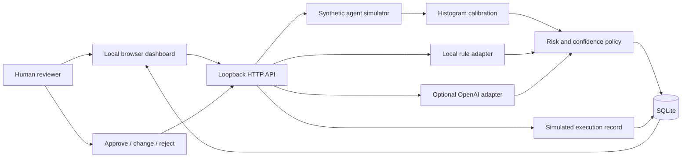

# Architecture and API

## Empirical preparation (v1.10)

Rejected POSTs with small request bodies drain at most 64 KiB with a 250 ms read timeout before returning 403, avoiding Windows TCP resets on unread input. Bodies are not parsed or processed. Host, Origin and session-token validation still precede every write.

The source-draft catalog adds plans for the 15 original incidents without starter plans. Exact incident ID/URL matching selects a draft; explicit local recovery reviews still take precedence. No review decision is inserted by the catalog. The additional five-case staging set is separate and carries provisional provenance. The reference-queue script does not pool datasets or accept references.

`understanding.py` stores per-assessor randomized item mappings and append-only rubric ratings. Packets mask condition, participant IDs, timing, confidence and automatic assessments, while exposing evidence, reference steps, final plan and explanation needed for human scoring. Only the assessor's own latest rating is returned. Study closure is required, and packet creation/rating routes use same-origin POST checks. Codes and declarations do not authenticate identity; this remains supervised local research. Two-rater reporting joins actual trial IDs internally, preserves missingness and disagreements, and withholds condition means until both raters scored every completed trial.

## Research extension (v1.9)

`research.py` manages frozen study snapshots in a separate `research_studies` SQLite table. Explicit start/pause/resume/submit transitions accumulate server elapsed segments; `BEGIN IMMEDIATE` serializes transitions. Participants receive evidence and condition-appropriate original proposals, never study references or assessments before closure. A deterministic seeded crossover assigns different source groups to conditions, with order enforcement. Submitted trials cannot be overwritten; exclusions are explicit. This is a supervised local single-user pilot, not participant authentication.

Research GET routes return a redacted overview or trial; completed study export is gated until all trials finish or are excluded. POST routes use the app's existing Host/Origin/token checks and body limits. No new external network integration is introduced. Other project pages expose reference answers by design; the facilitator must prevent navigating to them during trials.

Plan-confidence analysis is computed separately for immutable dataset/model/prompt/evaluator cohorts. Latest-created attempts are selected before eligibility checks. It excludes teaching fixtures, non-public cases, missing accepted references, and failures; it checks cross-split source-group and evidence overlap. Fixed-bin Laplace fitting uses only calibration outcomes. Validation/test probabilities use that frozen mapping. No operational gating or Plan lab self-reported probability is changed.

`scripts/research_report.py` optionally generates missing offline public jobs, creates a comprehensive fixed-membership dashboard, and writes actual readiness/results to a runtime report directory. It never accepts a label/reference or fabricates participant data. The research protocol and presentation outline document the remaining empirical work.

## System boundary

CalibratedOps is a local single-user research application. The browser communicates with a Python standard-library server on loopback. SQLite is authoritative for incident states and audit records. The only optional external call is the OpenAI proposal request. No component has an infrastructure execution integration.

## Incident lifecycle

Creation stores a proposal and a snapshot of the threshold, risk, calibration score, support, and handoff reason. An eligible synthetic proposal becomes `auto_executed` immediately and receives a simulated execution event. Every custom incident and every gated synthetic case becomes `pending` with no action.

Only pending cases may transition to `approved`, `changed`, or `rejected`. Approval uses the original proposal. Change must use a different allowlisted action. Rejection has no action. Approved/changed decisions create a simulated execution event in the same transaction as the status change and human decision record.

`BEGIN IMMEDIATE` serializes writers. The submitted revision must match the stored revision. A committed review increments the revision; a duplicate or stale decision returns HTTP 409 without another execution. Failed transactions roll back both state and audit changes. There is no reopen/delete API.

## Calibration boundary

The simulator draws raw scores uniformly from 0.50 to 0.99 and makes correct proposals with probability `score ** 2`, intentionally producing overconfidence. Five-bin empirical calibration uses labeled training cases and a Beta(1,1) prior. High impact, fewer than 20 matching bin observations, or estimated correctness below threshold forces review.

The simulator calibration cannot establish a rule agent's or LLM's reliability. Those adapters receive `calibrated=null` and `support=0`, so review is mandatory regardless of raw confidence. Add a model- and distribution-specific calibration artifact before allowing automatic actions from another adapter. Version that artifact and retain it with experiment metadata.

## Local API

`GET /api/state` supplies a random process-local token to the same-origin frontend. Writes require an exact matching `Origin`, `Content-Type: application/json`, and `X-Review-Token`. Host validation and the fixed loopback bind restrict the expected browser origin. There is no CORS access. These controls protect the local browser workflow; they do not authenticate another program running as the same OS user.

| Method | Path | Input / result |
| --- | --- | --- |
| GET | `/api/state` | Latest 500 incidents, audit, latest 20 experiments, stats, config, write token |
| GET | `/api/export` | All incidents, complete audit, latest 20 experiments; token omitted |
| POST | `/api/generate` | `count` 1–50, `seed` 0–1,000,000 except reserved calibration seed 42 |
| POST | `/api/incidents` | `title`, `evidence`, `risk` low/medium/high, `agent` rules/openai |
| POST | `/api/decide` | `id`, `revision`, `decision` approved/changed/rejected, `replacement`, `reviewer`, `feedback`, `review_seconds` |
| POST | `/api/settings` | `threshold` 0–1; applies to future incident creation |
| POST | `/api/experiments` | `seed`, `repeats` 2–30, `test_size` 50–5,000, `threshold`, `reviewer_accuracy` |
| GET | `/api/datasets/example.csv` | Bundled fictional example CSV |
| POST | `/api/datasets` | Dataset `name`, `format`, `content`, optional group split `seed` |
| POST | `/api/dataset-experiments` | `dataset_id`, `target_accuracy`, `reviewer_accuracy`, outcome `seed` |
| GET | `/api/dataset-review?dataset_id=...` | Explicit unblinded evidence, labels, source notes, and reviews |
| GET | `/api/dataset-review-export?dataset_id=...` | Dedicated annotation JSON download |
| POST | `/api/dataset-label-review` | `dataset_id`, `record_id`, expected `revision`, `decision` accepted/corrected/flagged, `label`, `reviewer`, `explanation` |
| POST | `/api/reviewed-datasets` | Parent `dataset_id` and new `name`; requires every case resolved |

Dataset import has a separate 2 MiB content limit and an envelope allowance for JSON escaping. It validates whole imports before transactional storage. Dataset metadata is public to the local UI; raw records and labels remain server-side. Frozen predictions, group isolation, validation-only threshold selection, and limitations are described in [the dataset guide](DATASETS.md).

Label review is the explicit exception to hiding raw labels: the annotation endpoints return them to the reviewer, with full private history and source notes. They are not added to generic state or agent inputs. Version creation runs in one immediate transaction and copies a private review snapshot while preserving parent records and prior experiment results. See [the annotation workflow](LABEL_REVIEW.md).

Static assets are allowlisted, request bodies are limited to 64 KB, text is length-limited, numerical values must be finite, and booleans are not accepted as numbers. The frontend escapes untrusted text before rendering it. A restrictive Content Security Policy loads scripts/styles from the local app. API credentials are never returned to the browser or exports.

Ground-truth labels are available only in the evaluation backend and completed synthetic incident views. Audit proposal events do not contain hidden labels. Local users with direct database/source access can inspect labels; this is not a blinded study platform.

## Extending the project

Version 1.8 adds `plan_batches.py` and `plan-batches.js`. New batches prepare all underlying jobs atomically from one consistent review-workspace read. Comparison dashboards only reference existing jobs and cannot initiate generation. Batch claims serialize processing; pause/resume and interruption recovery preserve completed or failed attempts. Structural metrics are explicitly revealed, separated by reference quality and returned model, and paired by incident for human comparisons. See [batch dashboards](PLAN_BATCHES.md) for storage, endpoints, denominator definitions, and limitations.

Version 1.7 adds `plan_agents.py`, `plan_jobs.py`, and the **Plan lab** interface. Jobs freeze evidence, reference, model/prompt identity, and original proposals; human decisions append independent revisions. Generation claims use immediate SQLite transactions, while provider calls occur outside transactions. One attempt per job prevents silent paid retries. Explicit reference reveal is separate from ordinary proposal reads. The plan comparator checks occurrence matching, execution order, and declared/transitive dependencies; no semantic or operational validation is claimed. See [Plan lab](PLAN_LAB.md) for endpoints and research limits.

Version 1.5 adds `dataset_recovery_reviews` and `recovery_plans.py`. Plan annotations use independent revision checks and append-only rows; accepted plans are frozen in reviewed versions' private source context and review snapshots. `/api/recovery-plan-review` and `/api/recovery-plan-check` use the existing POST protections. The structural checker matches action occurrences and checks explicit prerequisite order without executing steps. Recovery references are kept out of agent inputs. See [recovery plans](RECOVERY_PLANS.md).

Version 1.4 adds `diagnostics.py` and the explicit read-only routes `/api/dataset-diagnostics?experiment_id=...` and `/api/dataset-diagnostics-export?experiment_id=...`. They read the frozen dataset and stored calibration/selection values without refitting or calling an agent. Case-level test answers are disclosed only through these unblinded routes; bootstrap state and generic experiment exports remain aggregate. See [failure analysis](FAILURE_ANALYSIS.md).

Version 1.3 adds append-only `dataset_date_reviews` and JSON-backed `prediction_runs`. Run claims and writes use immediate SQLite transactions; provider calls occur outside transactions. Each run has one in-flight case, with explicit recovery and capped manual retries. The browser drives sequential processing, while results survive reloads in SQLite. Finalization copies frozen predictions and source/review provenance into a new dataset in one transaction. See [prediction runs](PREDICTION_RUNS.md) for lifecycle, usage, and single-server constraints.

Additional routes: GET `/api/prediction-run?id=...` and `/api/prediction-run-export?id=...`; POST `/api/prediction-runs`, `/api/prediction-next`, `/api/prediction-control`, `/api/prediction-finalize`, and `/api/dataset-date-review`. All writes use the existing same-origin token checks. Prediction details expose agent outputs, never ground-truth labels. Date-review exports remain part of the explicit unblinded annotation workspace.

To add an agent, return an allowlisted `action`, finite `confidence` in [0,1], and a concise `explanation` from observable evidence. The adapter must not receive a hidden evaluation label. Record provider/model/version metadata and force review until appropriate calibration evidence is available.

To add a representative dataset, separate development, calibration, validation, and test partitions by incident/site/time. Fit calibration only on its dedicated partition, choose policy thresholds on validation, and freeze both before evaluating the final test set. The current `Case` type represents a single acceptable action; real datasets may need a set of acceptable actions or a utility function.

Public deployment would require a production server, authenticated reviewer identities, authorization, session management, operational safeguards, and suitable storage. The current server intentionally has no public bind option.
